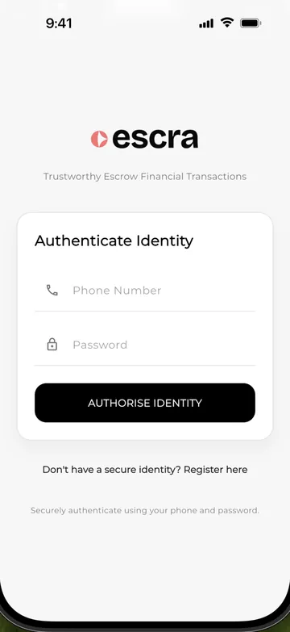

# Escra

A Flutter mobile app for trustworthy escrow transactions between buyers and sellers, with funds held in escrow until the buyer confirms delivery.

[](https://youtube.com/shorts/EGoR1_HW-zM)
[](https://flutter.dev)

**Demo video:** [youtube.com/shorts/EGoR1_HW-zM](https://youtube.com/shorts/EGoR1_HW-zM)

## Screenshots

<p>
  
</p>

*Sign-in with phone number and password*

## Features

**Accounts and identity**
- Sign up as a **buyer** or a **seller** with name, phone, email, password and a 4-digit transaction PIN.
- Sign in with phone number and password, with a 30-second lockout after three failed attempts.
- Seller onboarding step that captures business name, RC number, address and a CAC certificate or passport/NIN document. The document upload is simulated in the app.
- Access token and user profile kept in the platform keychain/keystore (`flutter_secure_storage`). The session is restored on cold start and checked against the server in the background.

**Escrow**
- Sellers create escrow orders for a buyer identified by email or phone, with title, description, amount, delivery mode and sales channel.
- Sellers share a payment link for an order through the system share sheet.
- Anyone can look up an order by its reference (`ESC-...`) and see a public preview.
- Buyers pay for an order from their Escra wallet (authorised with their PIN) or by card or bank transfer through **Kora checkout**, opened in an in-app browser.
- Sellers mark orders as shipped (tracking reference, optional proof URL) and as delivered, cancel unfunded orders, or refund the buyer.
- Buyers confirm delivery with a 4-digit code to release funds, or open a dispute with a reason.
- Order screens show live status and a lifecycle tracker (created, funded, shipped, delivered, released), with pull-to-refresh on the dashboard.

**Wallet**
- Live balance and transaction history from the backend.
- Deposit through a Kora checkout page.
- Payouts authorised with the transaction PIN, by three routes:
  - **Internal:** to another Escra user's wallet.
  - **Bank (Kora):** bank list and account-name lookup from Kora.
  - **Crypto (Quidax):** withdrawal to a crypto wallet.
- All money is handled as integer kobo and formatted as naira only in the UI.

**Profile (role-aware)**
- Buyers: account settings, security and PIN, payment methods (add a card with a live card preview) and support.
- Sellers: business details (view and edit), payout settings (Kora bank list, account-name lookup, payout frequency), verification status (KYC tier checklist), store analytics (sample data), security and PIN, and support.

**Support**
- FAQs, a simulated live chat with keyword-based replies, and support tickets with a generated reference.

## Tech stack

| Area | Choice |
| --- | --- |
| Framework | Flutter, Dart `^3.11.1` |
| Dependency injection | `get_it` |
| State management | `ChangeNotifier` + `ListenableBuilder` (no third-party state library) |
| Networking | `dio` with custom interceptors |
| Payments | Kora checkout, bank lookup and payouts; Quidax crypto withdrawals (all through the Escra backend) |
| Secure storage | `flutter_secure_storage` (encrypted shared preferences on Android) |
| Platform | `url_launcher` (checkout pages), `share_plus` (order links) |
| Utilities | `uuid` (idempotency keys), `intl` (naira formatting), `google_fonts` (Montserrat) |
| Linting | `flutter_lints` |

## Architecture

Feature-first clean architecture. Each feature under `lib/features/` is split into `data/`, `domain/` and `presentation/`; cross-cutting code lives in `lib/core/`.

```
presentation (screens, widgets)
      │  ListenableBuilder
      ▼
domain (AuthController, EscrowController)
      │  abstract repositories
      ▼
data (models, Http*Repository)  ──►  core/api (ApiClient + interceptors)  ──►  Escra REST API
```

- **Layers.** Repositories are abstract contracts (`AuthRepository`, `EscrowRepository`, `WalletRepository`) with HTTP implementations (`HttpAuthRepository`, `HttpEscrowRepository`, `HttpWalletRepository`) that map backend JSON into app models.
- **Dependency injection.** `lib/dependency_injection.dart` registers everything with `get_it` as lazy singletons at startup: secure storage, interceptors, `Dio`, `ApiClient`, repositories and controllers.
- **State management.** `AuthController` and `EscrowController` extend `ChangeNotifier`; screens rebuild through `ListenableBuilder`. `EscrowController` listens to `AuthController` and reloads orders when the session changes. Seller business and payout details live in a singleton `MerchantProfileStore` (also a `ChangeNotifier`).
- **Routing.** An auth gate in `main.dart` switches between the auth screen, a splash during session restore, and a four-tab shell (Dashboard, Orders, Wallet, Profile) held in an `IndexedStack`. Screens are pushed imperatively through `EscraRouter` (`lib/core/utils/escra_router.dart`), which provides a custom fade route and a slide-up route.
- **Backend.** The app talks to the Escra payment backend (`https://escra-payment-backend.onrender.com/api/v1`) through `ApiClient`, a `Dio` wrapper with 60-second timeouts and two interceptors:
  - `AuthInterceptor` attaches `Authorization: Bearer <access_token>` from secure storage. Public routes such as login and register opt out. On a 401 it signs the user out.
  - `IdempotencyInterceptor` adds a fresh UUID `Idempotency-Key` header to every POST, PUT and PATCH, so retries and double taps cannot repeat a payment.
- **Payments.** Kora and Quidax are reached only through the backend. The app requests a Kora checkout URL for an order or a wallet deposit and opens it with `url_launcher`. Kora's webhook goes to the backend, not to the app.
- **API reference.** `escra-api-routes.md` documents the backend routes the client was built against.

## Getting started

**Requirements:** Flutter with Dart SDK `^3.11.1` (the lockfile resolves against Flutter 3.38.4 or later).

```bash
git clone https://github.com/mofixiu/escra-mobile.git
cd escra-mobile
flutter pub get
flutter run
```

**Configuration:**
- **API base URL:** set in `lib/core/api/api_client.dart`; it points at the deployed backend by default.
- **Public order links:** `lib/core/config.dart` holds the base URL used for shared order links (`publicOrderBaseUrl`) and a backend preview fallback.
- **Secrets:** none. The app needs no API keys; Kora and Quidax credentials stay on the backend. Create an account from the sign-up screen to try it.

## Project structure

```
lib/
├── core/
│   ├── api/              # ApiClient (Dio) and auth/idempotency interceptors
│   ├── secure_storage/   # SecureStorageService over flutter_secure_storage
│   ├── theme/            # AppColors, AppTheme
│   ├── utils/            # EscraRouter, currency and date helpers
│   └── config.dart       # public order link URLs
├── features/
│   ├── auth/             # sign-in, sign-up, seller onboarding
│   ├── escrow/           # orders, checkout, delivery and disputes
│   ├── profile/          # buyer/seller profiles, settings, support
│   ├── shared/           # PIN pad, buttons, cards
│   └── wallet/           # balance, deposits, payouts
├── dependency_injection.dart
└── main.dart
```

## Author

Built by **Mofiyinfoluwa Ebo** ([@mofixiu](https://github.com/mofixiu)) for the Kora Hackathon.
Portfolio: [mofiyinebo.com](https://mofiyinebo.com)
